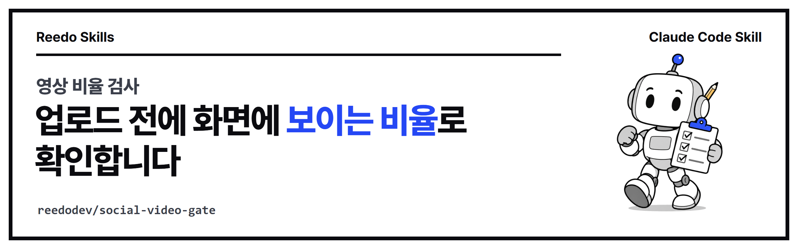

<p align="center"></p>

<p align="center">
<a href="https://github.com/reedodev/social-video-gate/actions/workflows/test.yml"></a>


</p>

# 영상 비율 검사 (social-video-gate)

릴스·쇼츠·틱톡·유튜브에 올릴 영상의 비율을 파일 숫자가 아니라 화면에 실제로 보이는 크기로 계산합니다. 휴대폰 영상의 회전 정보와 정사각형이 아닌 픽셀까지 반영하고, 맞지 않으면 업로드 전에 멈춥니다.

<!-- prereq-adapt -->
## 무엇이 필요한가요?

꼭 필요한 것은 Node 18 이상, FFmpeg의 `ffprobe`, 올릴 최종 영상 파일, 업로드 화면의 미리보기입니다. 권장·선택 준비물까지 정리한 표는 [SKILL.md의 준비물](skills/social-video-gate/SKILL.md#준비물-쓰기-전에-있어야-하는-것)에 있습니다.

## 바꿔 쓰기

에이전트에게 다음처럼 말하면 옵션을 바꿔서 실행합니다.

- "인스타 피드용 4:5 영상이야" → `--ratio 4:5` (최소 크기는 `--min 1080x1350`)
- "우리 채널은 1080x1920만 받아" → `--target reels --min 1080x1920`
- "권장 해상도 경고 기준을 바꿔 줘" → `--rec 1440x2560`

말과 옵션의 대응표는 [SKILL.md의 바꿔 쓰기](skills/social-video-gate/SKILL.md#바꿔-쓰기-이렇게-말하세요)에 있습니다.

## 설치

**Claude Code 플러그인으로 설치**

```
/plugin marketplace add reedodev/social-video-gate
/plugin install social-video-gate@social-video-gate
```

**폴더만 복사**

```bash
git clone https://github.com/reedodev/social-video-gate.git
cp -r social-video-gate/skills/social-video-gate ~/.claude/skills/
```

필요한 것: Node 18+, ffprobe(FFmpeg)

## 바로 해 보기

```bash
node skills/social-video-gate/scripts/video-gate.mjs final.mp4 --target reels
```

자세한 절차, 옵션, 한계는 [SKILL.md](skills/social-video-gate/SKILL.md)에 있습니다. 에이전트가 이 파일을 읽고 그대로 따릅니다.

## 시험

`node tests/run.mjs`가 SKILL.md 형식을 검사하고 예시 파일로 스크립트를 실제로 실행합니다. 푸시할 때마다 GitHub Actions가 같은 시험을 돌립니다(위 test 배지).

<!-- credits -->
## 출처와 영감

- **영상 정보 읽기**: [FFmpeg의 ffprobe](https://ffmpeg.org/ffprobe.html)를 불러 씁니다. FFmpeg는 따로 설치하며 그 라이선스를 따릅니다.
- **비율과 해상도 기준**: 9:16, 16:9, 1:1과 최소·권장 해상도는 각 플랫폼이 널리 안내하는 값을 작성자가 정리한 것이고, 플랫폼 정책은 바뀔 수 있습니다. 올리기 전에 해당 플랫폼의 최신 도움말과 실제 업로드 미리보기를 확인합니다.

## 만든 사람

**리도**, AI 좌충우돌 실습 중인 20년차 엔지니어입니다. 매일 AI에게 일을 맡기다가 막힌 부분을 고쳐 가며 이 스킬을 만들었습니다.
[YouTube @Reedodev](https://www.youtube.com/@Reedodev) · [Threads @reedo.dev](https://www.threads.com/@reedo.dev) · [GitHub @reedodev](https://github.com/reedodev)

같이 만든 다른 스킬: [옵시디언 3D 지식그래프](https://github.com/reedodev/obsidian-brain-3d) · [노트 먼저 찾아보기](https://github.com/reedodev/vault-recall) · [작업 기록 강의자료](https://github.com/reedodev/work-to-lecture-deck) · [한국어 말투 점검](https://github.com/reedodev/korean-tone-check) · [네이버 황금키워드](https://github.com/reedodev/naver-golden-keywords) · [한글 양식 채우기](https://github.com/reedodev/hwpx-form-fill) · [TTS 끝소리 고치기](https://github.com/reedodev/tts-tail-fix) · [카드뉴스 렌더](https://github.com/reedodev/html-card-render) · [유튜브 게시 점검](https://github.com/reedodev/youtube-publish-checklist)

---

## English

Check the displayed aspect ratio of a video (rotation metadata and non-square pixels included) for Reels, Shorts, TikTok, YouTube or square, and fail before upload on mismatch.

**Credits.**
- Uses [ffprobe](https://ffmpeg.org/ffprobe.html) from FFmpeg (installed separately). Ratio and resolution targets are commonly published platform values collected by the author; platforms change their rules, so check the current help pages and the real upload preview.

Install: `/plugin marketplace add reedodev/social-video-gate` then `/plugin install social-video-gate@social-video-gate`, or copy `skills/social-video-gate` into `~/.claude/skills/`. See [SKILL.md](skills/social-video-gate/SKILL.md) for the full procedure. MIT License; third-party models, fonts and libraries keep their own licenses.
